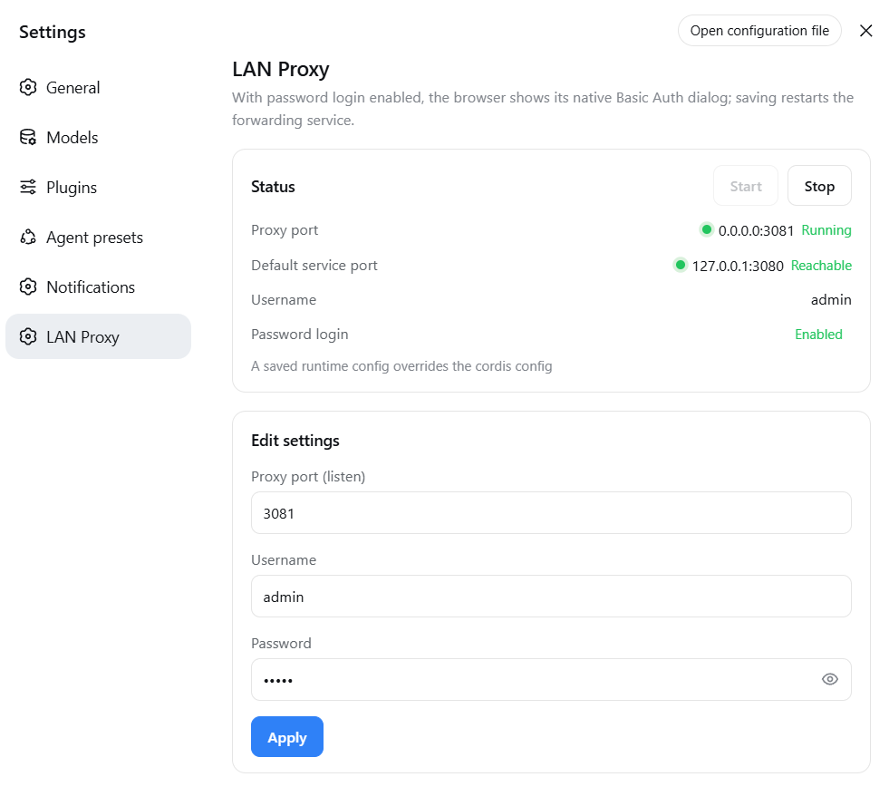
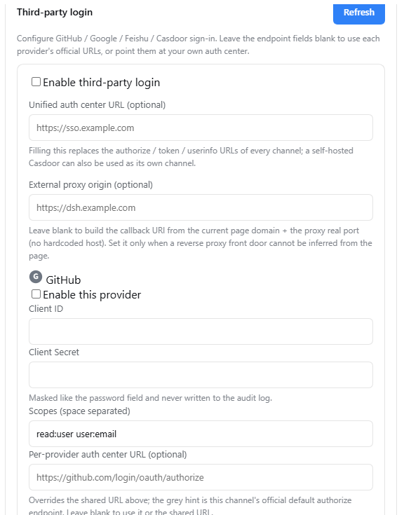
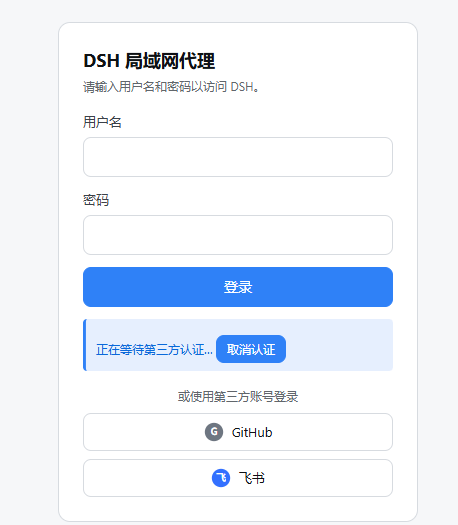

# dsh-proxy

English | [中文](README.md)

An HTTP + WebSocket reverse proxy that forwards a LAN port to the local DSH service `127.0.0.1:3080`.
The DSH plugin edition ships built-in **third-party sign-in** (GitHub / Google / Feishu / Casdoor) alongside Basic Auth, LAN access, and `crypto.randomUUID` polyfill injection.

## DSH plugin (recommended · dsh-proxy)

**Recommended for DSH (DeepSeek Harness) users**: install the proxy as a plugin into the web profile — it **starts and stops with `dsh web`**, no separate process or downloadable binary needed, with a full settings page.

- Full HTTP + WebSocket forwarding; a **self-contained login page + sessions** by default, optional **third-party sign-in** (GitHub / Google / Feishu / Casdoor), and the browser's native **Basic Auth** dialog as an alternative
- **Settings page** (DSH settings → LAN Proxy): status lights, start/stop, edit the proxy listen port, username, and password (form pre-fills current values; empty means set blank)
- Empty credentials by default = password login off; password login turns on only when **both** username and password are set

<p align="center">
  
</p>

### Third-party sign-in (the headline feature)

On top of local username/password (or Basic Auth), the plugin ships built-in **third-party sign-in** for **GitHub / Google / Feishu / Casdoor** — the core extension that sets this plugin apart from the original dsh-proxy.

- **Zero-config official endpoints**: every channel is off by default; with no OAuth config the plugin behaves exactly as before. Enabling an official channel (GitHub / Google / Feishu) needs only `clientId` + `clientSecret` — authorize, token and userinfo URLs come from each platform's official defaults.
- **Self-hosted auth center**: point `oauth.authCenter.baseUrl` at a self-hosted Casdoor and all three channels follow it; a built-in fourth `casdoor` provider signs in with Casdoor accounts directly.
- **Whitelist binding**: passing the IdP is not enough — the `(provider, subject)` pair must exist in the binding table, otherwise the sign-in is refused. `Bind before signing in`; unbinding requires a second confirmation.
- **Same session system**: a successful third-party sign-in issues the **same session cookie** as a password login, with logout, expiry and the live session list. The login page shows inline icon buttons for enabled channels only; authorization happens in a popup and the page never navigates.
- **Security**: `clientSecret` is masked just like the password and is never written to the audit log; custom endpoints require HTTPS; most token-exchange failures are credential mismatches (`invalid_client`, HTTP 401).

<p align="center">
  
  <br /><sub>Settings page "Third-party login": configure each channel's clientId / clientSecret and the self-hosted auth center</sub>
</p>

<p align="center">
  
  <br /><sub>Authorization happens in a popup; the page shows "Waiting for third-party authentication…" with cancel and a 3-minute timeout</sub>
</p>

#### Exposed endpoints

All auth endpoints live under the proxy-fronting prefix `/__dsh-proxy/` and need no extra port; the OAuth callback is hit directly by the IdP, so it must be reachable at the external/LAN address you register:

| Endpoint | Method | Purpose |
|---|---|---|
| `/__dsh-proxy/login` | GET | The login page (any unauthenticated path also renders the same page) |
| `/__dsh-proxy/logout` | GET | Log out, clears the current session cookie |
| `/__dsh-proxy/oauth/<id>/start` | GET | Begin **sign-in**: 302 to the IdP authorize page (with PKCE + state) |
| `/__dsh-proxy/oauth/<id>/bind/start` | GET | Begin **binding**: requires the one-shot `ticket` from settings (`?ticket=`) |
| `/__dsh-proxy/oauth/<id>/callback` | GET | **Callback**: IdP redirects here; `code` → token → userinfo → issue/bind session |

`<id>` is the channel: `github` / `google` / `feishu` / `casdoor`. The redirect URI to register at the IdP is exactly `<proxy-external-origin>/__dsh-proxy/oauth/<id>/callback` — by default it **follows the domain and port the browser actually used to reach the proxy** (e.g. `http://192.168.1.5:3081/...`; a direct loopback is `http://127.0.0.1:3081/...`), so no hardcoded host is needed. Only pin `oauth.publicOrigin` when a TLS reverse proxy's external name cannot be inferred from the request.

#### Authorization flow

1. **Create the IdP app**: register a new OAuth app at GitHub / Google / Feishu / Casdoor, with the redirect URI above (the "Third-party login" settings page shows the copy-ready URI from the current domain + the proxy's real port).
2. **Enable and configure the channel**: DSH settings → LAN Proxy → Third-party login, enter the `clientId` / `clientSecret` (official endpoints need only these two), and turn the channel on; for a self-hosted Casdoor also set `baseUrl` (or `authCenter.baseUrl`).
3. **Bind before signing in**: under "Account bindings" click "Bind GitHub" (etc.) → a popup goes through `/oauth/<id>/bind/start` + `callback` and writes `(channel, stable subject)` into the binding table. An account that passes the IdP but is not bound is refused.
4. **Sign in**: visit `http://<LAN-IP>:3081/`; the login page shows inline buttons only for enabled channels. Clicking one opens a popup to `/oauth/<id>/start` → IdP authorize → back to `callback`, which exchanges `code` for a token, reads the user info, checks the binding, and issues the same session cookie as a password login; the popup closes and the opener navigates to `/`.
5. **Session management**: after sign-in, the settings page lists active sessions, and you can log out or revoke one; under `cleartextAuth: 'basic'` there is no session/logout concept.

Full configuration examples, deployment checklist and troubleshooting: [`dsh-proxy/README.md`](dsh-proxy/README.md), section "Third-party login".

### Install

**Online install (recommended)** — directly from GitHub, no need to download the repository:

```bash
dsh plugin --profile web add github:stack-brain/dsh-proxy#master
```

**Local install** (repository cloned/downloaded on this machine):

```bash
dsh plugin --profile web add file:C:/mydata/codes/dsh-proxy
```

After restarting `dsh web`, visit `http://<your-LAN-IP>:3081` and you get the login page; enable third-party channels in the settings page to sign in with them (the native Basic Auth dialog appears only with `cleartextAuth: 'basic'`).
Details: [`dsh-proxy/README.md`](dsh-proxy/README.md).

## Standalone executables (go/ and node/)

Alternative when you do not use DSH or need a separate process: two equivalent single-file builds (interactive start, config memory, non-interactive CLI flags). **Basic Auth only — no third-party sign-in like the plugin edition.**

**Download install**: grab the single executable for your platform from [GitHub Releases](https://github.com/stack-brain/dsh-proxy/releases) (Go ~6-7 MB / Node ~80-120 MB), put it anywhere and run it; on macOS/Linux `chmod +x` first.

| Directory | Language | Single-file size | Notes |
|---|---|---|---|
| [`go/`](go/) | Go (static) | 6-7 MB | Lightweight; Go standard library, ~95% smaller, recommended |
| [`node/`](node/) | Node.js (SEA) | 83-119 MB | Original; packaged with Node's official SEA, no Node install needed |

Full download, features, build and verification instructions: [`STANDALONE.en.md`](STANDALONE.en.md).

## Releases

Pushing a `v*` tag (e.g. `v1.1.0`) triggers GitHub Actions, which **builds both the Node and Go versions**
and publishes them to the GitHub Release (with SHA256SUMS.txt checksums); you can also trigger it manually from the Actions page:

```bash
git tag v1.1.0
git push origin v1.1.0
```

Workflow: `.github/workflows/release.yml`.

## Origin & Credits

This project is a modified and extended version based on the source code of [smanx/dsh-proxy](https://github.com/smanx/dsh-proxy). Thanks to the original author.

- Source: https://github.com/smanx/dsh-proxy
