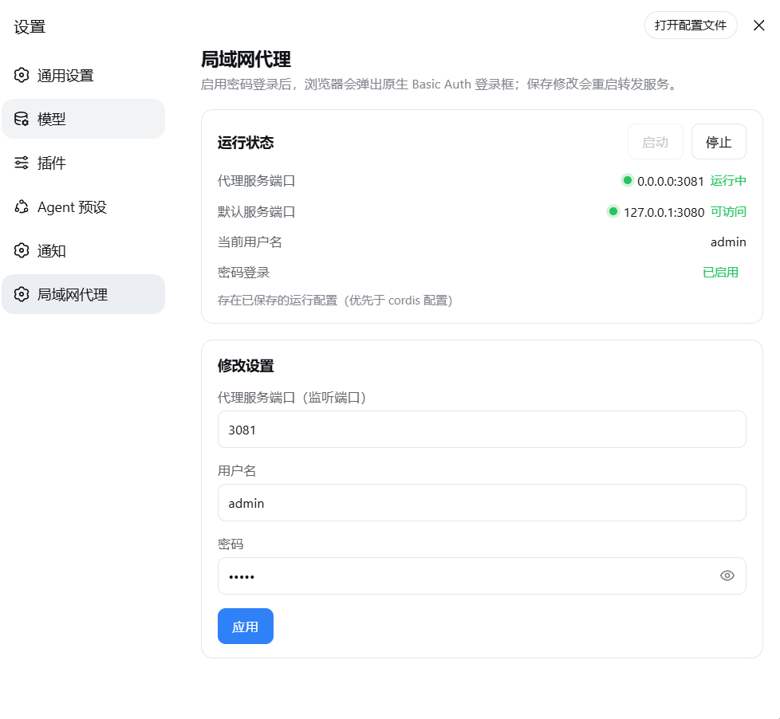
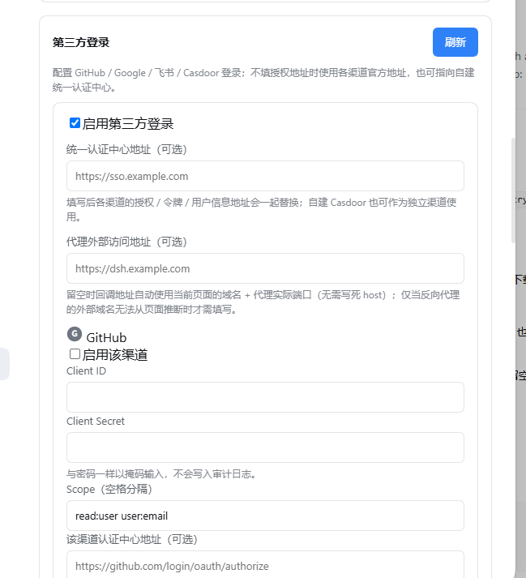
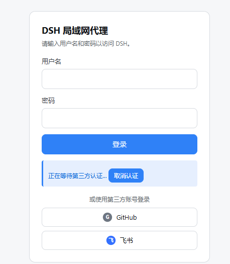

# dsh-proxy

[English](README.en.md) | 中文

HTTP + WebSocket 反向代理：把局域网端口转发到本地 DSH 服务 `127.0.0.1:3080`。
DSH 插件版内置**第三方认证登录**（GitHub / Google / 飞书 / Casdoor），并支持 Basic Auth、局域网访问与 `crypto.randomUUID` polyfill 注入。

## DSH 插件版（推荐 · dsh-proxy）

**推荐 DSH（DeepSeek Harness）用户使用**：把代理作为插件装进 web profile，**随 `dsh web` 启停**，无需单独进程、无需下载可执行文件，带完整设置页面。

- HTTP + WebSocket 全协议转发；默认**自带登录页 + 会话**，可启用**第三方登录**（GitHub / Google / 飞书 / Casdoor），也可切回浏览器原生 **Basic Auth** 弹窗
- **设置页面**（DSH 设置 → 局域网代理）：状态红绿灯、启动/停止、改代理监听端口与用户名密码（表单回写当前值，留空即设为空）
- 默认空凭据 = 密码登录关闭；**同时设置**用户名和密码才启用

<p align="center">
  
</p>

### 第三方认证登录（本插件最大亮点）

除本地用户名密码（或 Basic Auth）外，插件内置**第三方认证登录**，支持 **GitHub / Google / 飞书 / Casdoor** 四种渠道——这是本插件相对原版 dsh-proxy 最核心的扩展能力。

- **开箱即用**：默认所有渠道关闭；不配置任何 OAuth 时插件行为与旧版完全一致。启用官方渠道（GitHub / Google / 飞书）只需填 `clientId` + `clientSecret`，授权、令牌、用户信息地址自动取各平台官方地址。
- **自建认证中心**：`oauth.authCenter.baseUrl` 指向自建 Casdoor 后，三个渠道路径整体改走该服务；也可内置第四个 `casdoor` 渠道直接用 Casdoor 账号登录。
- **白名单式账号绑定**：三方账号通过 IdP 认证后，还必须在「账号绑定」表中存在才会签发会话，未绑定一律拒绝。`先绑定再登录`，解绑需二次确认。
- **同一套会话体系**：第三方登录成功签发与密码登录**相同的会话 Cookie**，同样支持登出、过期与活动会话列表；登录页只在已启用的渠道上显示内联图标按钮，授权在弹窗内完成、原页面不跳转。
- **安全细节**：`clientSecret` 与密码同样掩码输入、不写入审计日志；自定义端点要求 HTTPS；令牌交换失败多为凭据不匹配（`invalid_client`，HTTP 401）。

<p align="center">
  
  <br /><sub>设置页「第三方登录」：配置各渠道的 clientId / clientSecret 与自建认证中心</sub>
</p>

<p align="center">
  
  <br /><sub>授权在弹窗内完成，原页面显示「正在等待第三方认证…」，可取消或 3 分钟超时</sub>
</p>

#### 暴露的接口

所有认证相关接口都挂在代理前的统一前缀 `/__dsh-proxy/` 下，无需额外开放端口；其中 OAuth 回调由 IdP 直接访问，需在外网/局域网可达的地址上注册：

| 接口 | 方法 | 用途 |
|---|---|---|
| `/__dsh-proxy/login` | GET | 登录页（未认证访问任意路径也会呈现同一登录页） |
| `/__dsh-proxy/logout` | GET | 登出，清除当前会话 Cookie |
| `/__dsh-proxy/oauth/<id>/start` | GET | 发起**登录**授权：302 跳转到 IdP 授权页（带 PKCE + state） |
| `/__dsh-proxy/oauth/<id>/bind/start` | GET | 发起**绑定**授权：需设置页下发的一次性 `ticket`（`?ticket=`） |
| `/__dsh-proxy/oauth/<id>/callback` | GET | **回调接口**：IdP 授权后回跳此处，`code` 换 token、取用户信息、签发/绑定会话 |

`<id>` 为渠道：`github` / `google` / `feishu` / `casdoor`。需注册到 IdP 的回调地址即 `<代理外部地址>/__dsh-proxy/oauth/<id>/callback`——该地址默认**自动跟随浏览器当前访问代理的域名与端口**（如 `http://192.168.1.5:3081/...`，直连本机为 `http://127.0.0.1:3081/...`），无需写死；只有当 TLS 反代的外域名无法从请求推断时，才用 `oauth.publicOrigin` 固定。

#### 授权流程

1. **在 IdP 创建应用**：于 GitHub / Google / 飞书 / Casdoor 新建 OAuth 应用，把回调地址填为上面那一条（设置页「第三方登录」会直接给出当前域名 + 代理真实端口的可复制地址）。
2. **启用并配置渠道**：DSH 设置页 → 局域网代理 → 第三方登录，填入对应 `clientId` / `clientSecret`（官方端点仅需这两项），开启渠道；自建 Casdoor 再填 `baseUrl`（或 `authCenter.baseUrl`）。
3. **先绑定再登录**：在「账号绑定」点「绑定 GitHub」等按钮 → 弹窗走 `/oauth/<id>/bind/start` + `callback`，把 `(渠道, 稳定标识)` 写入绑定表。未绑定的账号即使通过 IdP 也会被拒绝。
4. **登录**：访问 `http://<LAN-IP>:3081/`，登录页只显示已启用的渠道按钮；点击后弹窗访问 `/oauth/<id>/start` → 跳转 IdP 授权 → 回跳 `callback` 完成 `code` 换 token、读取用户信息、校验绑定 → 签发与密码登录相同的会话 Cookie，弹窗关闭、主页面跳转到 `/`。
5. **会话管理**：登录后在设置页可查看活动会话、登出或踢出；`cleartextAuth: 'basic'` 模式下无会话/登出概念。

完整配置示例、部署检查清单与故障排查见 [`dsh-proxy/README.zh.md`](dsh-proxy/README.zh.md) 的「第三方登录」章节。

### 安装

**在线安装（推荐）**——直接从 GitHub 安装（无需下载仓库）：

```bash
dsh plugin --profile web add github:stack-brain/dsh-proxy#master
```

**本地安装**（仓库已克隆/下载到本机）：

```bash
dsh plugin --profile web add file:C:/mydata/codes/dsh-proxy
```

重启 `dsh web` 后，访问 `http://<局域网IP>:3081` 会看到登录页；在设置页启用第三方渠道后可用对应账号授权登录（`cleartextAuth: 'basic'` 时才是浏览器原生弹窗）。详细说明见 [`dsh-proxy/README.zh.md`](dsh-proxy/README.zh.md)。

## 独立可执行版本（go/ 与 node/）

不使用 DSH、或需要独立进程时的备选方案：两个等价的单文件版本（交互式启动、配置记忆、CLI 免交互参数）。**仅支持 Basic Auth，不含 DSH 插件版（`dsh-proxy/`）的三方认证登录。**

**下载安装**：从 [GitHub Releases](https://github.com/stack-brain/dsh-proxy/releases) 下载对应平台的单个可执行文件（Go 版约 6-7 MB / Node 版约 80-120 MB），放到任意目录直接运行；macOS/Linux 先 `chmod +x`。

| 目录 | 语言 | 单文件体积 | 说明 |
|---|---|---|---|
| [`go/`](go/) | Go（静态编译） | 6-7 MB | 轻量版；Go 标准库实现，体积小 95%，推荐 |
| [`node/`](node/) | Node.js（SEA 打包） | 83-119 MB | 原版；用 Node 官方 SEA 打包，无需安装 Node |

完整的下载、功能、构建与验证说明见 [`STANDALONE.md`](STANDALONE.md)。

## 自动发布

推送 `v*` 标签（如 `v1.1.0`）即触发 GitHub Actions，**同时构建 Node 版和 Go 版**
并发布到 GitHub Release（含 SHA256SUMS.txt 校验和）；也可在 Actions 页面手动触发：

```bash
git tag v1.1.0
git push origin v1.1.0
```

工作流见 `.github/workflows/release.yml`。

## 项目来源与致谢

本项目是在 [smanx/dsh-proxy](https://github.com/smanx/dsh-proxy) 的代码基础上进行修改和扩展而来，在此向原作者致谢。

- 来源：https://github.com/smanx/dsh-proxy
